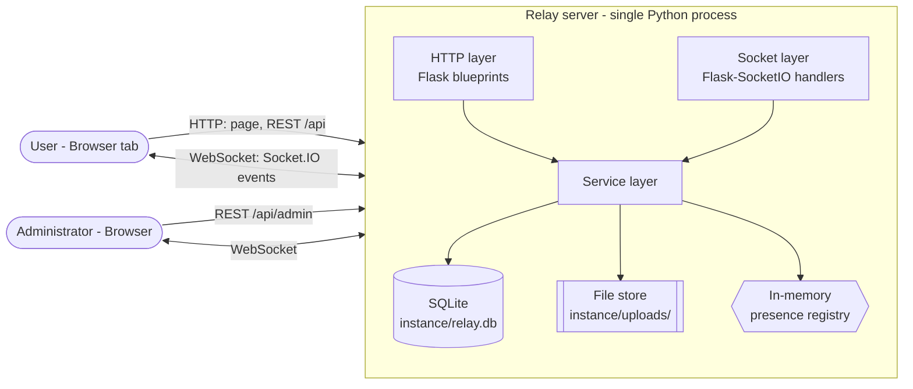
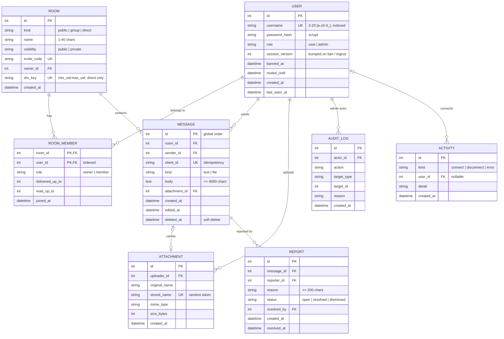
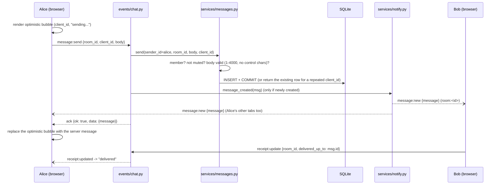

# Relay — Software Architecture Document (SAD)

| | |
|---|---|
| **Project** | Relay — real-time chat application (Problem Statement: Chat Application, Socket Programming) |
| **Course** | UE24CS341A Software Engineering — Section E, Team 8 |
| **Owner** | Lakshmi Narasimha Moorty Perepa (Developer 1, Backend) |
| **Status** | v1.0 — realises [SRS v2.0](srs.md); baseline for Sprints 1–2 |
| **Related** | [SRS](srs.md) · [Test Plan](test-plan.md) · [Features](features.md) · [Sprint plan](sprint-plan.md) |

---

## 1. Goals and drivers

| Driver | What it means for the design |
|---|---|
| **Real-time over sockets** (the problem statement) | A persistent WebSocket per browser tab carries all live chat traffic. HTTP is used only where request/response fits better. |
| **Four people building in parallel over two sprints** | A frozen **event contract** (section 5) and **REST contract** (section 6) let the backend, frontend and tests be built independently and still fit together. |
| **Submitted SRS v1.0** | Every v1.0 requirement (CHAT-F-001…017) maps to a concrete mechanism (section 5.8), so the v2.0 features never break the v1.0 scope. |
| **Many features, short timeline** | One uniform messaging pipeline: the public chat, group rooms and private (1:1) conversations are all rooms. Every feature plugs into the same `room → message` path. |
| **Traceability for evaluation** | Each module maps to one epic, one SRS section and one owner (section 12), so the RTM can point at real code. |
| **Zero-setup demo on a LAN** | Python + SQLite. There is no external database or message broker to install. |

## 2. Technology stack

| Layer | Choice | Why | Rejected alternative |
|---|---|---|---|
| Language | Python 3.11 | Course-recommended; the whole team knows it | Node.js — would split the team across two ecosystems |
| Web framework | Flask 3.0 | Small, explicit and well documented | Django — too much framework for a two-sprint build |
| Real-time | **Flask-SocketIO 5.3** (server) + **Socket.IO client 4.7.5** (browser, vendored) | Rooms, acknowledgements, automatic reconnect and heartbeat built in, over a real WebSocket transport | Raw `websockets` — we would hand-build rooms, acks and reconnection |
| Async mode | `threading` + `simple-websocket` | Works on Windows, macOS and Linux with no eventlet/gevent monkey-patching | eventlet — deprecated, and fragile on Windows |
| Persistence | SQLite via Flask-SQLAlchemy 3.1 | File-based and zero-config; the ORM lets us move to PostgreSQL by changing one URL | PostgreSQL — every developer would have to install and run it |
| Auth | Flask-Login session cookie + Werkzeug password hashing (scrypt) | One session shared by HTTP and the socket handshake | JWT — needs extra token plumbing on the socket for no gain here |
| Frontend | Vanilla JS (ES modules) + CSS, served by Flask | No build step; easy to debug; enough for a chat UI | React — adds a toolchain and a learning curve |
| Quality | pytest, Flask-SocketIO test client, ruff, GitHub Actions | Fast feedback on every PR | — |

## 3. System context



**Deployment unit:** one process (`python run.py`) on the demo laptop, bound to `0.0.0.0:5000`. Teammates and evaluators connect from their browsers over the LAN.

## 4. Backend structure

### 4.1 Layers

```
 Transport (thin)   relay/api/*.py (REST blueprints)     relay/events/*.py (Socket.IO handlers)
                              \                                /
 Domain                        relay/services/*.py   <- ALL business rules
                              /                                \
 Persistence        relay/models/*.py (SQLAlchemy)       instance/uploads/ (files)
```

These rules are checked in every review:

1. **Handlers are thin.** They parse input, call service function(s), and return the result as JSON or an ack. They contain no business rules.
2. **Services own every rule** (membership, mute/ban, limits, ownership, admin role). REST and socket paths call the same service, so a rule can never be enforced on one path and missed on the other.
3. **Services never import `flask.request`.** They take plain arguments (`user_id`, `room_id`, `body`), which keeps them unit-testable. `current_app.config` is allowed.
4. **Only `relay/services/notify.py` calls `socketio.emit`** (and enters/leaves Socket.IO rooms). Handlers and other services call `notify.*`, so a REST action, such as an admin deleting a message, reaches live clients exactly like a socket action.
5. **Errors are `RelayError(code, message, **details)`** and are mapped centrally to HTTP responses and ack envelopes (section 5.6).
6. **The sender/actor always comes from the session** (`current_user`), never from a payload field.
7. **Commit first, then broadcast.** A message counts as sent only once it is committed. Ordering is the autoincrement `message.id`.

**Registration points are written once.** `relay/__init__.py`, `relay/api/__init__.py` and `relay/events/__init__.py` import every module from the first commit on; modules that are not built yet exist as placeholders. Later PRs replace module contents and never edit the registration points, which keeps parallel PRs free of merge conflicts.

### 4.2 Module map

| Module | Responsibility | Epic |
|---|---|---|
| `relay/__init__.py` | App factory: config, extensions, security headers, blueprints, CLI, `#general` | — |
| `relay/config.py` | Configuration and limits (section 4.3) | — |
| `relay/extensions.py` | `db`, `login_manager`, `socketio` singletons; session-user loader | — |
| `relay/errors.py` | `RelayError`, `ok()`, `fail()`, `HTTP_STATUS` | — |
| `relay/models/` | SQLAlchemy entities (section 7) | all |
| `relay/services/auth.py` | Register, verify credentials, session revocation | E1, E2 |
| `relay/services/rooms.py` | `#general`, group rooms, DMs, membership, invite join | E3, E5 |
| `relay/services/messages.py` | Validate, send (idempotent), edit, delete, history | E3 |
| `relay/services/receipts.py` | Delivered/read watermarks, unread counts | E4 |
| `relay/services/presence.py` | In-memory `sid ↔ user` registry (F-015), online list | E1, E4 |
| `relay/services/sync.py` | Reconnect catch-up | E4 |
| `relay/services/files.py` | Upload validation, storage, access checks | E6 |
| `relay/services/search.py` | Message search scoped to the user's rooms | E7 |
| `relay/services/moderation.py` | Reports, bans, mutes, admin deletes | E8 |
| `relay/services/audit.py` | Append-only audit log | E8 |
| `relay/services/activity.py` | Server activity log and connected-client view (F-052) | E8 |
| `relay/services/notify.py` | The only place that calls `socketio.emit` | all |
| `relay/api/*.py` | REST endpoints (section 6) | per file |
| `relay/events/_ack.py` | `@acked` decorator: envelope, session guard, error containment | E1 |
| `relay/events/connection.py` | Handshake auth, presence, channel joins | E1, E4 |
| `relay/events/chat.py` | Send, edit, delete, receipts, sync | E3, E4 |
| `relay/events/presence.py` | Typing indicators | E4 |
| `relay/cli.py` | `create-admin`, `seed-demo` | — |
| `relay/static/js/` | Browser client (section 9) | per module |

### 4.3 Configuration

`Config`: `SECRET_KEY`, `HOST` (`0.0.0.0`), `PORT` (5000), `DEBUG`, `SQLALCHEMY_DATABASE_URI` (from `DATABASE_URL`, default `sqlite:///relay.db` → `instance/relay.db`), `SQLALCHEMY_ENGINE_OPTIONS = {"connect_args": {"timeout": 15}}`, `SESSION_COOKIE_HTTPONLY = True`, `SESSION_COOKIE_SAMESITE = "Lax"`, `CORS_ORIGINS` (comma-separated env; empty = same-origin only), `MAX_UPLOAD_BYTES` (10 MB), `MAX_CONTENT_LENGTH = MAX_UPLOAD_BYTES + 512 KB`, `MESSAGE_MAX_LEN = 4000`, `HISTORY_PAGE_SIZE = 50`, `UPLOAD_DIR = "uploads"` (inside `instance/`), `PRESENCE_GRACE_SECONDS = 3`.

`TestConfig(Config)`: `TESTING = True`, `SECRET_KEY = "test"`, in-memory SQLite, `PRESENCE_GRACE_SECONDS = 0`.

## 5. Real-time design (Socket.IO)

All timestamps are ISO-8601 UTC strings ending in `Z` (e.g. `"2026-11-03T10:15:02Z"`) or `null`. All IDs are integers.

### 5.1 Channels

Each connected socket is placed in these Socket.IO rooms (server-side channels):

| Channel | Members | Used for |
|---|---|---|
| `user:<user_id>` | every socket of that user | `room:added`, `room:removed`, `session:terminated` |
| `room:<room_id>` | sockets of every member of that room (DMs included) | messages, receipts, typing, `room:updated` |
| `presence` | all authenticated sockets | `presence` |

**Room kinds:** `public` (exactly one: `#general`, name `"general"`, created at app start; every registered user is a member), `group` (user-created, `visibility` `public|private`, creator = owner), `direct` (1:1 DM, exactly two members, unique `dm_key = "<min_uid>:<max_uid>"`).

The **public chat** (v1.0 "broadcast to all eligible users", F-005) is therefore a normal `room:<general_id>` broadcast. **Private messages** (F-006) go to a two-member `direct` room whose channel contains only the two users' sockets (SR-003).

On connect, a socket joins `user:<id>`, `presence` and `room:<id>` for every room the user belongs to. Membership changes (join, leave, a new DM) update the channels of **all** that user's live sockets through `notify.subscribe` / `notify.unsubscribe`.

### 5.2 Connection lifecycle

```mermaid
sequenceDiagram
    participant C as Browser
    participant S as Relay server
    participant DB as SQLite
    C->>S: WebSocket handshake (session cookie)
    alt no valid session, stale session version, or user banned
        S-->>C: connection refused (connect handler returns False)
    else authenticated
        S->>S: registry.add(sid, user); activity "connect"; join user:/room:/presence channels
        S-->>C: connected
        S--)C: presence:snapshot {users} (this socket only)
        S--)Others: presence {user, online: true} (only for the user's first live socket)
        C->>S: sync {cursors: {room_id: last_message_id}}
        S->>DB: messages with id > cursor, per room (max 200 per room)
        S-->>C: ack {ok, data: {rooms, messages, unread}}
    end
    Note over C,S: ... later the connection drops ...
    C--xS: disconnect
    S->>S: registry.remove(sid); activity "disconnect"
    S->>S: last socket? set last_seen_at, start the 3 s grace timer
    S--)Others: presence {user, online: false} (after the grace period, unless the user reconnected)
```

The **3-second grace period** (`PRESENCE_GRACE_SECONDS`, 0 in tests) stops a page refresh from flashing the user offline and online again for everyone else. Cross-origin handshakes are refused unless the origin is listed in `CORS_ORIGINS` (CHAT-SR-014).

### 5.3 Request/response envelope

Every client-to-server event uses a **Socket.IO acknowledgement**, and every REST JSON body uses the same envelope:

```jsonc
{ "ok": true,  "data": { ... } }
{ "ok": false, "error": { "code": "FORBIDDEN", "message": "Human-readable text", "details": { ... } } }   // details optional
```

**Every** ack-ed event first checks that its `sid` is still registered **and** that the session is still valid. If not, it returns `AUTH_REQUIRED` and does nothing (CHAT-SR-005). Unexpected exceptions are caught: the DB session is rolled back, activity `error` is logged, `INTERNAL` is acked, and the server keeps running (CHAT-F-013, F-017).

### 5.4 Client → server events (all with an ack)

| Event | Payload | Ack `data` | Server side effects | FR |
|---|---|---|---|---|
| `message:send` | `{room_id, body, client_id?, attachment_id?}` | `{message}` | if newly created → `message:new` to `room:<id>` | F-004, F-006, F-037 |
| `message:edit` | `{message_id, body}` | `{message}` | own messages only (else `FORBIDDEN`), not deleted → `message:updated` | F-029 |
| `message:delete` | `{message_id}` | `{}` | own messages only → soft delete → `message:updated` | F-030 |
| `receipt:update` | `{room_id, delivered_up_to?, read_up_to?}` | `{delivered_up_to, read_up_to}` | watermarks only move **forward**, capped at the newest message id; read ⇒ delivered; if changed → `receipt:updated` | F-027, F-040 |
| `typing:start` / `typing:stop` | `{room_id}` | `{}` | must be a member → `typing` to the room **excluding the sender's socket** | F-026 |
| `sync` | `{cursors: {"<room_id>": <last_message_id>}}` | `{rooms: [Room], messages: [Message], unread: {"<room_id>": n}}` | read-only. Messages with `id > cursor`, ascending, max 200 per room. Rooms with a missing or `0` cursor are skipped (the client loads their history when opened) | F-021, F-028 |

`client_id` is an optional string (1–64 chars) generated by the browser and unique per sender. A repeated send with the same `client_id` returns the original message instead of creating a duplicate, so a retry after a reconnect is **idempotent**. The client also uses it to swap its optimistic "sending…" bubble for the confirmed message.

The client sends `typing:start` at most once per 2 s while typing, and `typing:stop` after 3 s idle or on send.

### 5.5 Server → client events

| Event | Channel | Payload | FR |
|---|---|---|---|
| `message:new` | `room:<id>` | `{message}` | F-004, F-005, F-006 |
| `message:updated` | `room:<id>` | `{message}` (edit, own delete, or admin delete) | F-029, F-030, F-047 |
| `receipt:updated` | `room:<id>` | `{room_id, user_id, delivered_up_to, read_up_to}` | F-027 |
| `typing` | `room:<id>` minus the sender's sid | `{room_id, user: {id, username}, is_typing: bool}` | F-026 |
| `presence:snapshot` | the connecting socket only | `{users: [User public]}` (everyone online, self included) | F-009 |
| `presence` | `presence` | `{user: User public, online: bool}`. The client shows "<name> joined" / "<name> left" in `#general` (not persisted) | F-009, F-010, F-011 |
| `room:added` | `user:<id>` | `{room: Room}` (viewer-specific: may include `invite_code`) | F-006, F-022, F-023 |
| `room:removed` | `user:<id>` | `{room_id}` | F-023 |
| `room:updated` | `room:<id>` | `{room: Room}` (sent with `viewer_id = 0`, so **no** `invite_code` and no `peer`) | F-023 |
| `session:terminated` | `user:<id>` | `{reason: "logout" \| "banned"}`. The server then disconnects that user's sockets; the client stops reconnecting and shows the login screen with a notice | F-014, F-019, F-048 |

**Objects** are identical everywhere they appear (REST, acks, events):

**User (public)** — `user.to_public()`:
```json
{"id": 3, "username": "medha", "role": "user", "last_seen_at": "2026-11-03T10:15:02Z"}
```
**User (admin view)** — `user.to_admin()`: the public fields plus `"banned": false, "muted_until": null | "<iso>", "created_at": "<iso>"`. `muted_until` is null once the mute has expired.

**Room** — `room_to_dict(room, viewer_id)`:
```json
{"id": 7, "kind": "group", "name": "project-team", "visibility": "public", "owner_id": 2,
 "member_count": 3, "created_at": "<iso>"}
```
- `kind = "direct"`: also `"peer": <User public>`, and `name` is the peer's username.
- `kind = "group"` **and** the viewer is the owner: also `"invite_code": "<code>"` (never sent to anyone else, never in broadcasts).
- In `GET /api/rooms` each room also has `"unread": <int>`; in `GET /api/rooms/public` each room also has `"joined": <bool>`.

**Message** — `message.to_dict()`:
```json
{"id": 1042, "room_id": 7, "client_id": "c1b9...", "kind": "text", "body": "hello",
 "attachment": null,
 "sender": {"id": 3, "username": "medha"},
 "created_at": "<iso>", "edited_at": null, "deleted": false}
```
- `kind` is `"text"` or `"file"`. A file message may have an empty `body` (the caption is optional).
- A **deleted** message has `"deleted": true`, `"body": ""` and `"attachment": null`. The row is kept for ordering.

**Attachment** — `attachment.to_dict()`:
```json
{"id": 55, "name": "notes.pdf", "mime": "application/pdf", "size": 182344, "is_image": false, "url": "/api/files/55"}
```

**Receipt** — `{"user_id": 4, "delivered_up_to": 1040, "read_up_to": 1038}` (watermarks, section 5.7).

**Report** — `report.to_dict()`:
```json
{"id": 9, "reason": "spam", "status": "open", "created_at": "<iso>", "reporter": "bob",
 "message": {"id": 1042, "room_id": 7, "body": "...", "deleted": false, "sender": "carol", "created_at": "<iso>"}}
```

**Audit entry** — `{"id", "actor": "<username>", "action", "target_type", "target_id", "reason", "created_at"}`
**Activity entry** — `{"id", "kind": "connect"|"disconnect"|"error", "user": "<username>"|null, "detail", "created_at"}`
**Connected client** — `{"sid": "<first 8 chars>", "username", "connected_at": "<iso>"}`

### 5.6 Error codes

All codes come from `RelayError` and are the same across sockets and REST:

| Code | HTTP | Meaning |
|---|---|---|
| `AUTH_REQUIRED` | 401 | No valid session (also returned when a socket's session has been revoked) |
| `INVALID_CREDENTIALS` | 401 | Wrong username or password (one generic message for both) |
| `FORBIDDEN` | 403 | Logged in but not allowed (not the owner, not an admin, no access to the file) |
| `BANNED` | 403 | Account is banned |
| `MUTED` | 403 | Sender is muted; `details.until` gives the ISO expiry |
| `NOT_FOUND` | 404 | Room, message, user, file or report does not exist **or is not visible to you** (non-members get `NOT_FOUND` for rooms) |
| `VALIDATION_ERROR` | 400 | Payload failed validation |
| `INVALID_INVITE` | 400 | Bad or unknown invite code |
| `USERNAME_TAKEN` | 409 | Registration conflict |
| `PAYLOAD_TOO_LARGE` | 413 | Upload over 10 MB |
| `UNSUPPORTED_TYPE` | 415 | Upload type not allowed, or content does not match the extension |
| `INTERNAL` | 500 | Unexpected error, logged server-side; **no details are sent to the client** |

**Limits and validation** (the server is authoritative; the client mirrors them for UX):

| Item | Rule |
|---|---|
| Username | normalised with `strip().lower()`; must match `^[a-z0-9_]{3,20}$` |
| Password | at least 8 characters; never logged, never returned |
| Message body | `strip()`ped; 1–4000 chars (may be empty only when an attachment is present); no control characters `\x00-\x08 \x0b \x0c \x0e-\x1f \x7f` (newline and tab allowed); must be a string |
| `client_id` | optional string, 1–64 chars, unique per sender |
| Room name | `strip()`ped, 1–40 chars; `visibility` ∈ `public`, `private` |
| History page | `limit` default and max **50**; `before` = exclusive message id; returned **oldest-first** |
| Sync | at most **200** missed messages per room |
| Search | `q` stripped, 2–100 chars; case-insensitive substring; `%`, `_` and `\` are literal; max **50** results, newest first; only rooms the user is a member of; deleted messages excluded |
| Upload | max **10 MB**; allow-list with magic-byte check: png, jpg/jpeg, gif, webp, pdf, txt, md, csv, zip, docx, xlsx, pptx; an empty file → `VALIDATION_ERROR` |
| Report / sanction reason | 1–200 chars (required for report, ban and mute; optional for unban, unmute and dismiss) |
| Mute | `minutes` integer, **15–10080** (7 days) |

### 5.7 Ordering, delivery and receipts

- **Ordering:** the message primary key (autoincrement) is the global order. Clients sort by `id`, never by client clock.
- **Delivery guarantee:** a message counts as *sent* only once it is committed. The server commits first and then broadcasts, so anything a client has seen is persisted. Offline members get it through `sync` or history (F-021).
- **Receipts as watermarks:** `room_member.delivered_up_to` and `room_member.read_up_to` store message IDs, which costs O(members) storage instead of O(members × messages). Message `m` is delivered/read by a member when `delivered_up_to >= m.id` / `read_up_to >= m.id`. Unread count = messages in the room with `id > read_up_to`, not sent by me and not deleted.
- **Reconnect** (F-028): the Socket.IO client reconnects automatically (`reconnectionDelay` 1 s, capped at `reconnectionDelayMax` 10 s). After reconnecting it emits `sync` with the last ID it holds per room and merges the results by `id`, so duplicates cannot occur.

### 5.8 How the SRS v1.0 requirements are realised

| v1.0 requirement | Mechanism |
|---|---|
| F-001 Connect via configured IP/port | The browser opens `http://<host>:<port>`; Socket.IO upgrades to a WebSocket (TCP) on the same address; `HOST`/`PORT` come from `.env` |
| F-002 Request username | The login screen is shown before any chat view; the socket connects only after login (F-019) |
| F-003 / SR-002 Unique usernames | `user.username` is a unique column; the same account in two tabs is one user, not two identities |
| F-004 Send text | `message:send` event with an ack |
| F-005 Broadcast public messages | `#general` public room; broadcast to `room:<general_id>` |
| F-006 / SR-003 Private messages | `direct` room with exactly two members; emitted only to its channel |
| F-007 Display without refresh | Server push `message:new`; the client store re-renders |
| F-008 Timestamps | `message.created_at` set by the server at commit; shown in local time |
| F-009 Online users list | Presence registry; `presence:snapshot` on connect, then `presence` deltas |
| F-010 / F-011 Join / leave notices | `presence` events on first connect / last disconnect (after the 3 s grace period), shown as notices in `#general`; not persisted |
| F-012 Concurrent clients | Flask-SocketIO threading mode, one thread per connection; tested with 20+ clients (NF-005) |
| F-013 Unexpected disconnects | The `disconnect` handler cleans the registry; handler exceptions are caught per event and never stop the server |
| F-014 Graceful termination | Logout → `session:terminated` → sockets disconnected; presence updates |
| F-015 Username ↔ socket mapping | Presence registry `sid → user_id` plus `user_id → {sid}` |
| F-016 / SR-004 Reject invalid messages | `services.messages.validate_body` (non-empty after trim, ≤ 4000 chars, no control characters) → `VALIDATION_ERROR` |
| F-017 Communication errors | Uniform ack envelope with error codes (5.6); a "Reconnecting…" banner on the client |
| SR-001 / SR-005 Invalid or dead connections | `connect` refuses sockets without a valid session; events from a `sid` no longer in the registry, or with a revoked session, get `AUTH_REQUIRED` |

## 6. REST API

REST is used for **request/response resources** (auth, uploads, lists, search, admin). WebSocket is used for **live conversation state**. All endpoints are under `/api`, use JSON in and out (except uploads and downloads), and require a session unless marked *public*.

| Method & path | Request | Success response `data` | Notes / errors | FR |
|---|---|---|---|---|
| `GET /api/health` *(public)* | — | body is `{"status": "ok"}` (no envelope) | liveness | — |
| `POST /api/auth/register` *(public)* | `{username, password}` | **201** `{user}` | logs in; joins `#general`; `VALIDATION_ERROR`, `USERNAME_TAKEN` | F-018 |
| `POST /api/auth/login` *(public)* | `{username, password}` | `{user}` | `INVALID_CREDENTIALS`, `BANNED` | F-019 |
| `POST /api/auth/logout` | — | `{}` | bumps `session_version` (all tabs' cookies die), emits `session:terminated {reason: "logout"}`, disconnects sockets | F-014 |
| `GET /api/auth/me` *(public)* | — | `{user}` or `{user: null}` | always 200 | F-019 |
| `GET /api/users?q=` | `q` prefix (optional) | `{users: [User public + "online": bool]}` | excludes self; ≤ 20, by username | F-006 |
| `GET /api/rooms` | — | `{rooms: [Room + unread]}` | rooms I am a member of (public, group, direct) | F-040 |
| `GET /api/rooms/public` | — | `{rooms: [Room + joined]}` | `#general` + group rooms with `visibility=public`; never private ones | F-023 |
| `POST /api/rooms` | `{name, visibility}` | **201** `{room}` | creator = owner and first member; `room:added` to the creator | F-022 |
| `POST /api/rooms/<id>/join` | — | `{room}` | public group rooms only (else `NOT_FOUND`); idempotent; on first join → `room:added` + `room:updated` | F-023 |
| `POST /api/rooms/join` | `{invite_code}` | `{room}` | private group room by code; `INVALID_INVITE` | F-022, F-023 |
| `POST /api/rooms/<id>/leave` | — | `{}` | group rooms only (else `VALIDATION_ERROR`); `room:removed` to me + `room:updated` to the room | F-023 |
| `POST /api/dms` | `{user_id}` | `{room}` (**201** if created, 200 if it existed) | `NOT_FOUND` unknown user; `VALIDATION_ERROR` self. On create, both members get `room:added` | F-006 |
| `GET /api/rooms/<id>/messages?before=&limit=` | — | `{messages: [Message] oldest-first, receipts: [Receipt]}` | members only | F-020 |
| `GET /api/search?q=&room_id=` | — | `{messages: [Message]}` | search rules in 5.6 | F-041 |
| `POST /api/files` | multipart, field **`file`** | **201** `{attachment}` | then sent with `message:send {attachment_id}`; an attachment can be used by one message only, and only by its uploader | F-037 |
| `GET /api/files/<id>` | — | the file bytes | uploader, or a member of the room where it was sent; else `FORBIDDEN` (401 if anonymous). Images inline, others `Content-Disposition: attachment`; always `X-Content-Type-Options: nosniff`, `Cache-Control: private, no-store` | F-038, F-039 |
| `POST /api/messages/<id>/report` | `{reason}` | **201** `{report: {id, status}}` | must be a member of the message's room (else `NOT_FOUND`); the same user reporting the same message twice → `VALIDATION_ERROR` | F-046 |
| `GET /api/admin/reports?status=open` | — | `{reports: [Report]}` | admin only (`FORBIDDEN`); status `open\|resolved\|dismissed` | F-047 |
| `POST /api/admin/reports/<id>/resolve` | `{action: "delete"\|"dismiss", reason?}` | `{report}` | `delete` soft-deletes the message (live `message:updated`) and marks the report `resolved`; `dismiss` marks it `dismissed` | F-047 |
| `DELETE /api/admin/messages/<id>` | `{reason?}` | `{}` | admin soft delete + `message:updated` | F-047 |
| `GET /api/admin/users` | — | `{users: [User admin]}` | admin only | F-048 |
| `POST /api/admin/users/<id>/ban` | `{reason}` | `{user}` (admin view) | sets `banned_at`, revokes sessions, `session:terminated {reason: "banned"}`, disconnects; admins cannot be targeted (`FORBIDDEN`) | F-048 |
| `POST /api/admin/users/<id>/unban` | `{reason?}` | `{user}` | | F-048 |
| `POST /api/admin/users/<id>/mute` | `{minutes, reason}` | `{user}` | 15–10080 | F-049 |
| `POST /api/admin/users/<id>/unmute` | `{reason?}` | `{user}` | | F-049 |
| `GET /api/admin/audit` | — | `{entries: [Audit]}` newest first, ≤ 200 | admin only | F-051 |
| `GET /api/admin/clients` | — | `{clients: [Connected client]}` | admin only | F-052 |
| `GET /api/admin/activity` | — | `{entries: [Activity]}` newest first, ≤ 200 | admin only | F-052 |
| `GET /` | — | HTML page `index.html` | not under `/api` | — |

**Audit actions** (exactly one row per effective action): `user.ban`, `user.unban`, `user.mute`, `user.unmute`, `message.delete`, `report.dismiss`. Resolving a report with `delete` writes **one** `message.delete` row. Ban, unban and unmute are no-ops (and write no row) when the user is already in that state.

**HTTP headers on every response:** `Content-Security-Policy: default-src 'self'; img-src 'self' data:; object-src 'none'; base-uri 'self'; frame-ancestors 'none'`, `X-Content-Type-Options: nosniff`, `Referrer-Policy: same-origin`. The session cookie is `HttpOnly` and `SameSite=Lax`. Unauthenticated access to a `@login_required` route returns **401** `{ok: false, error: {code: "AUTH_REQUIRED"}}` (JSON, not a redirect). A request body over the size limit returns **413** `PAYLOAD_TOO_LARGE`.

**Operator CLI** (`flask --app run …`): `create-admin <username>` (prompts for a password) and `seed-demo` (empty database only). Seed data: `admin / admin12345` (admin) and `alice, bob, carol, dave / password123`; `#general` with 3 messages; public room `project-team` (alice owner; bob and carol members); private room `secret-lab` (dave owner); a DM alice↔bob.

## 7. Data model



Table names are the lower-case class names. Timestamps are stored as naive UTC (`relay/models/_time.py`: `utcnow()` and `iso(dt) -> "…Z" | None`). All models are importable from `relay.models`; `room_to_dict` lives in `relay.models.room`. `User.get_id()` returns `"<id>:<session_version>"`; `User` has the properties `is_admin` and `is_muted`, and `Attachment` has `is_image`.

Key decisions:

- **DM = room with `kind = direct`.** The unique `dm_key` guarantees one DM per pair (F-006). History, receipts, files and search work unchanged for DMs.
- **Soft delete** (`deleted_at`): the row is kept for ordering, receipts and reports, but the body and attachment are never sent again, so the content is effectively gone (F-030).
- **Indexes:** `message(room_id, id)` for history, sync and unread counts; `room_member(user_id)` for the room list; unique `report(message_id, reporter_id)`. Search uses `LIKE` on `body` scoped to the user's rooms, which is sufficient for demo volumes.
- **Append-only audit log:** `AuditLog` has no update or delete path anywhere in the code (CHAT-NF-011, SR-012).
- **The schema is created with `db.create_all()`.** It changes only through PRs that update this section. Migrations are deferred, since no production data exists.

## 8. Key flows

### 8.1 Send a message (F-004)



### 8.2 Ban a user (F-048, CHAT-SR-013)

```mermaid
sequenceDiagram
    participant AD as Admin (browser)
    participant API as api/admin.py
    participant MOD as services/moderation.py
    participant AU as services/audit.py
    participant N as services/notify.py
    participant U as Banned user's tabs
    AD->>API: POST /api/admin/users/42/ban {reason}
    API->>MOD: ban(actor=admin, user_id=42, reason)
    MOD->>MOD: require_admin(actor); target is not an admin
    MOD->>MOD: set banned_at, bump session_version
    MOD->>AU: record(actor, "user.ban", "user", 42, reason)
    MOD->>N: terminate_sessions(42, "banned")
    N--)U: session:terminated {reason: "banned"}
    N->>U: disconnect every sid of user 42
    API-->>AD: 200 {ok: true, data: {user}}
```

**Session revocation:** each user row carries a `session_version`, which is part of the Flask-Login session id. It is checked on every request, on socket connect and on every socket event. Bumping it on logout or ban invalidates all existing cookies for that user immediately.

## 9. Frontend architecture

A single-page app made of plain ES modules served from `relay/static/js/`, with no build step:

| Module | Responsibility |
|---|---|
| `app.js` | Bootstraps: `GET /api/auth/me`, then routes to the login or chat view; wires reconnect + `sync` |
| `api.js` | `fetch` wrapper for REST that unwraps the envelope and turns errors into exceptions |
| `socket.js` | Owns the Socket.IO connection: `emitAck(event, payload)` returns a Promise over the ack envelope; reconnect banner |
| `store.js` | Single in-memory state (rooms, messages by room, presence, unread, typing) with a small `subscribe()` pub/sub. **Only `store.js` mutates state.** |
| `dom.js` | Safe DOM helpers (text nodes only) and time formatting |
| `views/*.js` | `login`, `sidebar`, `conversation`, `composer`, `dialogs`, `admin`. Each renders from the store and dispatches actions. |

The rendering rule (CHAT-SR-009): user content is inserted with `textContent` or `createTextNode` only, **never** with `innerHTML`. The index page has no inline `<script>` or `style=""` attributes that a CSP of `default-src 'self'` would block.

The Socket.IO client library (4.7.5) is vendored into `relay/static/vendor/` instead of loaded from a CDN. This keeps the CSP `default-src 'self'` and makes the LAN demo work without internet access.

## 10. Security architecture

| Concern | Mechanism | SRS ref |
|---|---|---|
| Credential storage | `werkzeug.security.generate_password_hash` (scrypt, salted); passwords are never logged or returned | CHAT-SR-006 |
| Authenticated sockets | The session is validated in the `connect` handler; unauthenticated, stale or banned connections are refused | CHAT-SR-007 |
| Dead or revoked sockets | Every socket event re-checks the registry and the session version | CHAT-SR-001, SR-005 |
| Authorisation | Every service function takes the actor's id and checks membership, ownership or the admin role; the sender always comes from the session, never from the payload; non-members get `NOT_FOUND` | CHAT-SR-008 |
| XSS | `textContent` rendering, server-side length and control-character validation, and the CSP header | CHAT-SR-009 |
| Upload safety | Extension allow-list plus magic-byte check, 10 MB cap, random stored names under `instance/` (outside `static/`), `Content-Disposition: attachment` for non-images, `X-Content-Type-Options: nosniff` | CHAT-SR-010 |
| Injection | SQLAlchemy ORM with bound parameters only; no string-built SQL; length limits on every field | CHAT-SR-011 |
| Accountability | Append-only `audit_log` for every admin action; admin role checked in the service layer | CHAT-SR-012 |
| Revocation | `session_version` bump plus forced disconnect on ban or logout | CHAT-SR-013 |
| Cross-site WebSocket hijacking | Socket.IO accepts same-origin handshakes only (extra origins only via `CORS_ORIGINS`); the session cookie is `SameSite=Lax` and `HttpOnly` | CHAT-SR-014 |

Out of scope by decision (*Won't*): rate limiting, account lockout, password reset, TLS termination (this is a LAN demo; a real deployment would add HTTPS through a reverse proxy) and end-to-end encryption.

## 11. Repository layout and ownership

`M` = Moorty, `V` = Viswajith, `S` = Medha, `P` = Naivadh. Only the owner edits a file; anyone else asks the owner through a hand-off request.

```
.
├── .github/workflows/ci.yml                 S   ruff + pytest on every push and PR
├── .github/pull_request_template.md         S
├── .github/ISSUE_TEMPLATE/*.yml             S
├── .gitignore  .env.example                 M
├── pyproject.toml                           M
├── requirements.txt  requirements-dev.txt   M
├── run.py                                   M   dev/LAN entry point
├── README.md                                P
├── CHANGELOG.md                             S
├── run-demo.bat  run-demo.sh                P
├── docs/
│   ├── architecture.md                      M   this file (SAD)
│   ├── srs.md  srs.docx                     P   SRS v2.0 + RTM + Appendix A deviations
│   ├── features.md                          P   MoSCoW list
│   ├── diagrams/                            P
│   ├── acceptance/                          P   sprint acceptance records
│   ├── demos/                               P   demo videos + script
│   ├── test-plan.md                         V
│   ├── testing/                             V   manual test execution records
│   ├── sprint-plan.md                       S
│   └── scrum/                               S   planning, stand-ups, review, retro notes
├── relay/
│   ├── __init__.py  config.py  extensions.py  errors.py  views.py  cli.py     M
│   ├── models/  services/  api/  events/    M
│   ├── templates/index.html                 V
│   └── static/{css,js,img,vendor}/          V
├── scripts/load_test.py  requirements-load.txt   V
└── tests/                                   V   conftest.py, unit/, integration/
```

## 12. Ownership by epic

| Epic | SRS § | Backend modules (Moorty) | Frontend modules (Viswajith) | Tests (Viswajith) |
|---|---|---|---|---|
| E1 Connection & Session | 4.1 | `events/connection`, `events/_ack`, `services/presence`, `services/notify` | `socket`, `app` | T2, T6 |
| E2 User Identity & Accounts | 4.2 | `api/auth`, `services/auth`, `api/users` | `views/login` | T3 |
| E3 Messaging | 4.3 | `events/chat`, `services/messages`, `api/rooms` (history) | `views/conversation`, `views/composer`, `store` | T4, T5, T6 |
| E4 Presence & Notifications | 4.4 | `services/presence`, `services/receipts`, `services/sync`, `events/presence` | `socket`, `views/sidebar` | T6, T7 |
| E5 Rooms | 4.5 | `api/rooms`, `services/rooms` | `views/sidebar`, `views/dialogs` | T5 |
| E6 File Sharing | 4.6 | `api/files`, `services/files` | `views/composer`, `views/conversation` | T7 |
| E7 Search | 4.7 | `api/search`, `services/search` | `views/dialogs` | T7 |
| E8 Administration & Moderation | 4.8 | `api/admin`, `services/moderation`, `services/audit`, `services/activity` | `views/admin` | T8 |

**Process roles:** Medha Singh (Scrum Master) owns CI, the PR template, the sprint plan, scrum notes and releases. Naivadh Shrivastava (Product Owner) owns the SRS, RTM, features list, diagrams, README, acceptance records and demos.

Working agreements that fall out of this design:

1. **Contract first.** Sections 5 and 6 are frozen. Any change goes through a change request that updates this document first, so nobody builds against a guessed payload.
2. **Paired testing.** Backend PRs carry no tests; for each one, Viswajith writes a test PR against the contract.
3. **The assignee raises the PR; the repo owner reviews and merges** (course rule). Medha approves the repo owner's own PRs.
4. **Every PR closes its GitHub issue(s)** with `Closes #NN`, so the GitHub Project board moves cards automatically.

## 13. Testing strategy

| Level | Tooling | Scope | Owner |
|---|---|---|---|
| Unit | pytest, in-memory SQLite | Services: every rule (membership, mute, limits, permissions) | Viswajith |
| Integration | Flask test client + `socketio.test_client` (several clients per test) | REST endpoints, socket events, broadcast fan-out, auth on connect | Viswajith |
| System / acceptance | Test cases `TC-*` from the [Test Plan](test-plan.md), two or more real browsers | Each acceptance criterion; results recorded in the RTM | Viswajith (execution), Naivadh (acceptance) |
| Non-functional | `scripts/load_test.py` (Socket.IO clients) | CHAT-NF-001 latency, NF-005 20+ clients, NF-006 ordering | Viswajith (Sprint 2) |

CI blocks merging to `develop` on lint or test failure. The coverage target for `relay/services` is ≥ 70 % (CHAT-NF-009).

## 14. Backlog: not built

These Could-tier items stay in the backlog and are **not built** in v1.0. Nothing in the code or the contract refers to them.

| Item | SRS ID |
|---|---|
| Invite-code management (regenerating codes; joining **by** code is built) | CHAT-F-024 |
| Owner room management (rename, remove members) | CHAT-F-025 |
| Emoji picker, reactions, replies, pins, @mentions, slash commands | CHAT-F-031 … F-036 |
| Browser notifications and per-room mute | CHAT-F-042 |
| Conversation export | CHAT-F-043 |
| Profiles and avatars | CHAT-F-044 |
| Blocking users | CHAT-F-045 |
| Admin room deletion | CHAT-F-050 |

## 15. Evolution path (out of scope, documented for completeness)

| Need | Change |
|---|---|
| More than one server process | `SocketIO(message_queue="redis://…")`, with the presence registry moved to Redis |
| Larger data volume | PostgreSQL via `DATABASE_URL`, plus Alembic migrations and full-text search |
| Internet deployment | Reverse proxy (nginx/Caddy) with TLS, a production WSGI server, and rate limiting |

## 16. Decision log

| # | Decision | Status |
|---|---|---|
| ADR-1 | Flask-SocketIO in `threading` mode over eventlet/gevent | Accepted |
| ADR-2 | Public chat, group rooms and private messages are all rooms (`public` / `group` / `direct`) | Accepted |
| ADR-3 | Receipts as per-member watermarks, not per-message rows | Accepted |
| ADR-4 | REST for resources, WebSocket for live state; only `notify.py` emits | Accepted |
| ADR-5 | Vanilla JS with no build step; Socket.IO client vendored | Accepted |
| ADR-6 | SQLite + `create_all()`, no migrations until there is real data | Accepted |
| ADR-7 | WebSocket (Socket.IO) instead of the raw TCP protocol in SRS v1.0 (see SRS Appendix A) | Accepted |
| ADR-8 | Session id `"<id>:<session_version>"` so logout and ban revoke every cookie at once | Accepted |
