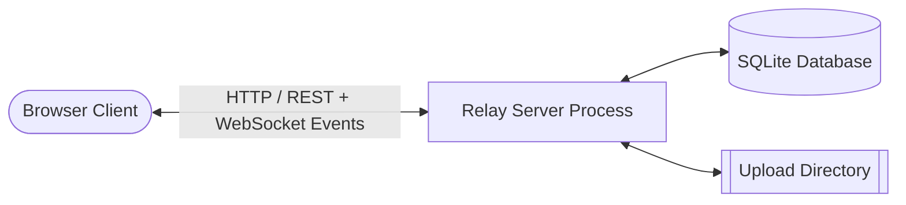

# Relay — Software Requirements Specification (SRS v2.0)

| | |
|---|---|
| **Project** | Relay: real-time chat application (Problem Statement: Chat Application, Socket Programming) |
| **Course** | UE24CS341A Software Engineering — Section E, Team 8 |
| **Document Version** | **v2.0** (2026-11-08) |
| **Owner** | Naivadh Shrivastava (Product Owner, SRN PES2UG24CS297) |
| **Baseline** | Aligned with Team Control File v1.0 and Software Architecture Document (SAD) v1.0 |
| **Related Documents** | [Features List](features.md) · [SAD](architecture.md) · [Test Plan](test-plan.md) · [Sprint Plan](sprint-plan.md) |

---

## 1. Introduction

### 1.1 Purpose
This document specifies the software requirements for **Relay**, a real-time multi-user web chat application built as part of the coursework for UE24CS341A Software Engineering. Version 2.0 refines the preliminary requirements submitted in SRS v1.0 into concrete, testable functional and non-functional specifications suitable for parallel implementation across two agile sprints.

### 1.2 Document Conventions
- **Requirement Identifiers:** 
  - `CHAT-F-001` through `CHAT-F-052` denote Functional Requirements.
  - `CHAT-NF-001` through `CHAT-NF-011` denote Non-Functional Requirements.
  - `CHAT-SR-001` through `CHAT-SR-014` denote Security Requirements.
- **Requirement Weights (MoSCoW):**
  - **Must:** Essential for Sprint 1 core chat functionality.
  - **Should:** Highly desirable features implemented in Sprint 2.
  - **Could:** Backlog items deferred post-v1.0.
  - **Won't:** Explicitly excluded architectural boundaries.
- **Traceability Status:**
  - `N`: Not started
  - `P`: In progress
  - `I`: Implemented
  - `A`: Accepted

### 1.3 Intended Audience & Reading Suggestions
This specification is intended for the course instructors and examiners, the development team members (Developer 1, Developer 2, Scrum Master, Product Owner), and evaluation reviewers. Readers seeking high-level scope should examine Section 2 and Section 4. Technical reviewers should focus on Section 3 (Interfaces), Section 4 (System Features), Section 7 (RTM), and Appendix A (Deviations).

### 1.4 Project Scope
Relay provides instantaneous bi-directional communication between concurrent browser clients through persistent WebSocket connections managed by a single Python server process. The system supports a persistent public lobby (`#general`), custom group channels, isolated 1:1 direct messaging, live typing indicators, presence tracking, read receipts, attachment sharing up to 10 MB, and administrative moderation tools (banning, muting, reporting, and immutable audit logs).

---

## 2. Overall Description

### 2.1 Product Perspective
Relay is a self-contained, monolithic web application engineered for zero-configuration local area network (LAN) and localhost operation. It relies on standard browser technologies (Vanilla ES modules and standard HTML5/CSS3) communicating over HTTP (for REST transactions and static assets) and WebSockets via Flask-SocketIO (for real-time duplex event streaming).

### 2.2 Product Functions
- **Real-Time Duplex Messaging:** Sending, editing, soft-deleting, and syncing messages across public, private group, and direct channels.
- **Presence & Session Management:** Tracking online status, connection grace periods, and instant session termination upon logout or ban.
- **Message Reliability:** Delivery and read receipt watermarks, offline catch-up synchronization, and idempotency guarantees using client tokens.
- **Rich Media & Discovery:** Scoped message text search and secure file attachment sharing with MIME verification.
- **Administrative Moderation:** Inappropriate message reporting, message purging, user muting, account banning, and tamper-resistant audit logs.

### 2.3 User Classes and Characteristics
1. **Visitor (Unauthenticated User):** Can view login and registration forms, submit credentials, and access basic health endpoints.
2. **Registered User:** Can join public rooms, create rooms, exchange direct messages, upload attachments, search history, and report violations.
3. **Room Owner:** The creator of a group room who holds administrative privileges over room membership and visibility.
4. **Administrator:** System operator capable of reviewing reports, executing bans and mutes, purging messages, and inspecting audit trails and active sockets.

### 2.4 Operating Environment
- **Server Platform:** Python 3.11+ on Windows, macOS, or Linux.
- **Data Persistence:** SQLite 3 with WAL mode enabled.
- **Client Runtime:** Modern Evergreen web browsers (Chrome, Edge, Firefox, Safari) with native ES module and WebSocket support.
- **Network Environment:** Localhost or LAN environments with configurable IP binding and CORS policies.

### 2.5 Design and Implementation Constraints
- Single Python server process with threading concurrency; zero external message brokers (e.g., Redis) or standalone DBMS installations.
- Plain JavaScript client without bundlers (e.g., Webpack, Vite) or front-end frameworks (e.g., React, Vue).
- All message inputs sanitized and rendered strictly via DOM text nodes to eliminate cross-site scripting vulnerabilities.

---

## 3. External Interface Requirements

### 3.1 User Interfaces
The user interface is a responsive, single-page application consisting of:
- **Authentication View:** Clean dual form for user login and registration.
- **Chat Workspace:** Two-column layout featuring a collapsible sidebar (conversations list, unread badges, active presence roster) and an active conversation pane.
- **Conversation Pane:** Chronological message list, status watermarks (sent, delivered, read), inline image previews, typing notice bar, and rich message composer.
- **Administrative Dashboard:** Dedicated management console displaying active socket clients, server activity logs, moderation queues, and audit tables.

### 3.2 Software Interfaces
- **Flask 3.0:** Web framework providing HTTP routing, session cookie handling, and static file serving.
- **Flask-SocketIO 5.3 & simple-websocket:** WebSocket protocol server engine supporting room-based multicast and acknowledgement callbacks.
- **Flask-SQLAlchemy 3.1:** Object-Relational Mapper abstracting SQLite storage with parameterized queries.
- **Werkzeug 3.0:** Cryptographic hashing implementing salted scrypt algorithms.

### 3.3 Communication Protocols
- **HTTP/1.1:** Used for initial document delivery, REST resource interactions under `/api/*`, and binary file transfer.
- **WebSocket (Socket.IO protocol v4):** Used for bi-directional event distribution, heartbeats, and client-server acknowledgements.

---

## 4. System Features (Functional Requirements)

### 4.1 Epic 1: Connection & Session Lifecycle
- **CHAT-F-001 (Connect):** The system shall establish and maintain a persistent WebSocket connection between the client browser and the server over the configured host and port.
- **CHAT-F-012 (Concurrent Clients):** The system shall reliably handle at least 20 concurrent client connections without connection dropping or performance degradation.
- **CHAT-F-013 (Survive Disconnects):** The system shall gracefully handle unexpected network disconnects, keeping server state intact and recovering on reconnection.
- **CHAT-F-014 (Graceful Termination):** The system shall terminate active socket sessions immediately when a user logs out, broadcasting offline presence to peers.
- **CHAT-F-015 (Username ↔ Socket Mapping):** The system shall maintain an in-memory thread-safe registry mapping active socket session IDs (`sid`) to authenticated user accounts.
- **CHAT-F-017 (Error Handling):** The system shall return uniform error response envelopes containing standard error codes for all failed socket events and REST requests.

### 4.2 Epic 2: User Identity & Accounts
- **CHAT-F-002 (Username Prompt):** The system shall present an authentication prompt to unauthenticated visitors prior to granting access to chat channels.
- **CHAT-F-003 (Unique Usernames):** The system shall enforce global uniqueness for user account names, rejecting conflicting registration attempts.
- **CHAT-F-018 (Register):** The system shall allow visitors to register new accounts by providing a username and password, storing credentials using salted scrypt hashing.
- **CHAT-F-019 (Login & Session):** The system shall authenticate user credentials, establish an HTTP session cookie, and bind socket connections to the session user.
- **CHAT-F-044 (User Profiles & Avatars):** *(Backlog)* The system shall support custom avatar uploads and bio descriptions.
- **CHAT-F-045 (User Blocking):** *(Backlog)* The system shall allow users to block specific peers from sending direct messages.

### 4.3 Epic 3: Messaging
- **CHAT-F-004 (Send Text):** The system shall allow authenticated users to send text messages to any room of which they are a member.
- **CHAT-F-005 (Broadcast):** The system shall broadcast messages posted in `#general` to all currently connected authenticated users.
- **CHAT-F-006 (Private Messages):** The system shall isolate direct 1:1 messages strictly to the two participating user sockets.
- **CHAT-F-007 (Live Display):** The system shall display incoming messages immediately in the user interface without requiring a browser refresh.
- **CHAT-F-008 (Timestamps):** The system shall record canonical UTC creation timestamps for all messages and render them in user-local time.
- **CHAT-F-016 (Reject Invalid):** The system shall reject message submissions that are empty, exceed 4,000 characters, or contain unprintable control characters.
- **CHAT-F-020 (History Pagination):** The system shall provide paginated message history loading (default 50 messages per page) ordered chronologically.
- **CHAT-F-029 (Edit Message):** The system shall allow authors to edit their sent messages, broadcasting updated content in real time.
- **CHAT-F-030 (Delete Message):** The system shall permit authors to delete their sent messages via soft deletion, removing body content while preserving order.
- **CHAT-F-031 — F-036 (Interactive Extensions):** *(Backlog)* Emoji reactions, message threading, message pinning, user mentions, rich markdown formatting, and slash commands.
- **CHAT-F-043 (History Export):** *(Backlog)* The system shall support downloading conversation transcripts as structured text files.

### 4.4 Epic 4: Presence & Notifications
- **CHAT-F-009 (Online List):** The system shall display a real-time list of currently connected online users.
- **CHAT-F-010 (Join Notice):** The system shall broadcast an ephemeral system notice when a user establishes their first active connection.
- **CHAT-F-011 (Leave Notice):** The system shall broadcast an ephemeral system notice when a user disconnects and fails to reconnect within the grace period.
- **CHAT-F-021 (Offline Delivery):** The system shall deliver unread messages that arrived while a user was offline upon their next connection.
- **CHAT-F-026 (Typing Indicators):** The system shall transmit live typing state indicators to active room participants with automatic 3-second expiration.
- **CHAT-F-027 (Receipts):** The system shall record monotonic delivery and read watermarks, rendering receipt checkmarks to message senders.
- **CHAT-F-028 (Reconnect & Sync):** The system shall enable reconnected clients to issue sync requests with last-seen message IDs to retrieve missed messages without duplicates.
- **CHAT-F-040 (Unread Counts):** The system shall maintain and display real-time counters of unread messages for every joined conversation.
- **CHAT-F-042 (Push Notifications):** *(Backlog)* The system shall trigger native browser notifications for mentions and direct messages.

### 4.5 Epic 5: Rooms
- **CHAT-F-022 (Create Room):** The system shall enable users to create group rooms with custom names, topics, and optional invite codes.
- **CHAT-F-023 (Browse/Join/Leave):** The system shall allow users to browse public channels, join via invite codes, and voluntarily exit rooms.
- **CHAT-F-024 (Invite Code Management):** *(Backlog)* The system shall allow room owners to regenerate or revoke room invitation tokens.
- **CHAT-F-025 (Owner Room Management):** *(Backlog)* The system shall allow room owners to rename rooms, edit topics, or expel members.

### 4.6 Epic 6: File Sharing
- **CHAT-F-037 (Share Files):** The system shall support uploading document and media attachments up to 10 MB per file.
- **CHAT-F-038 (Image Preview):** The system shall display inline image previews for supported graphic formats (PNG, JPEG, GIF, WebP).
- **CHAT-F-039 (Members-Only Download):** The system shall restrict file downloads strictly to authenticated members of the room where the attachment was posted.

### 4.7 Epic 7: Search
- **CHAT-F-041 (Search):** The system shall perform case-insensitive text search across message content scoped to the rooms joined by the querying user.

### 4.8 Epic 8: Administration & Moderation
- **CHAT-F-046 (Report):** The system shall enable members to submit moderation reports against objectionable messages.
- **CHAT-F-047 (Review Reports):** The system shall provide administrators with a review interface to resolve reports or soft-delete offending messages.
- **CHAT-F-048 (Ban/Unban):** The system shall enable administrators to ban user accounts, instantly revoking active sessions and rejecting logins.
- **CHAT-F-049 (Mute):** The system shall allow administrators to temporarily mute users, prohibiting message posting while allowing message viewing.
- **CHAT-F-050 (Admin Room Deletion):** *(Backlog)* The system shall allow administrators to delete group chat rooms permanently.
- **CHAT-F-051 (Audit Log):** The system shall maintain an immutable append-only audit trail recording all administrative moderation events.
- **CHAT-F-052 (Monitor Clients & Activity):** The system shall provide administrators with a real-time monitor displaying active socket connections and system operational events.

---

## 5. Non-Functional Requirements (NFRs)

- **CHAT-NF-001 (Performance & Latency):** The system shall achieve an end-to-end message broadcast latency of less than 200 ms under typical LAN operating conditions.
- **CHAT-NF-002 (Portability & Compatibility):** The web client shall operate consistently across major modern web browsers (Chrome, Edge, Firefox, Safari) without proprietary extensions.
- **CHAT-NF-003 (Network Resilience):** The client shall automatically attempt reconnection upon network failure with exponential backoff and resume message synchronization seamlessly.
- **CHAT-NF-004 (Minimal Footprint):** The application shall run as a standalone Python process without requiring external brokers, daemons, or separate database servers.
- **CHAT-NF-005 (Scalability):** The server shall support at least 20 simultaneous active WebSocket connections concurrently on modest hardware (e.g., 2 vCPU, 2 GB RAM).
- **CHAT-NF-006 (Message Ordering):** The system shall guarantee absolute monotonic chronological ordering of all messages within a conversation via server-assigned autoincrement primary keys.
- **CHAT-NF-007 (Zero-Config Deployment):** The system shall launch and function out-of-the-box using default SQLite configuration without manual schema setup.
- **CHAT-NF-008 (Storage Integrity):** The file storage subsystem shall strictly enforce a 10 MB per-attachment size limit and isolate uploaded binaries outside the web root.
- **CHAT-NF-009 (Test Coverage):** The core business service layer (`relay/services/`) shall maintain at least 70% automated unit and integration test coverage.
- **CHAT-NF-010 (Ease of Evaluation):** The repository shall include automated one-click execution scripts (`run-demo.bat` and `run-demo.sh`) enabling instant demonstration setup.
- **CHAT-NF-011 (Data Retention & Immutability):** Administrative audit log entries shall be strictly append-only; the application shall expose no code path to alter or delete audit history.

---

## 6. Security Requirements (SRs)

- **CHAT-SR-001 (Socket Session Validation):** Every client-to-server socket event shall verify that the connection holds a registered session and that the session version matches the user state.
- **CHAT-SR-002 (Identity Protection):** The system shall enforce username uniqueness and prevent identity spoofing across all communication channels.
- **CHAT-SR-003 (Channel Isolation):** Direct message socket events and database records shall be accessible solely to the two verified participants of the conversation.
- **CHAT-SR-004 (Input Sanitization):** The server shall validate all incoming payload data types, reject message bodies over 4,000 characters, and strip dangerous control characters.
- **CHAT-SR-005 (Session Token Revocation):** When a user session is revoked (via logout, password change, or admin ban), all associated live sockets shall be disconnected immediately.
- **CHAT-SR-006 (Credential Security):** User passwords shall be hashed using salted scrypt algorithms via Werkzeug; plain-text passwords shall never be persisted or logged.
- **CHAT-SR-007 (Handshake Authentication):** Unauthenticated WebSocket connection attempts shall be rejected at the handshake stage.
- **CHAT-SR-008 (Server-Side Authorization):** All access control checks (room membership, room ownership, administrative role) shall be executed exclusively within the server service layer.
- **CHAT-SR-009 (Cross-Site Scripting Defense):** Client code shall render untrusted user content using DOM `textContent` or text nodes exclusively, reinforced by a strict Content Security Policy (`default-src 'self'`).
- **CHAT-SR-010 (File Upload Safety):** Uploaded attachments shall undergo strict file extension allow-listing, magic-byte inspection, and randomized storage path generation.
- **CHAT-SR-011 (SQL Injection Immunity):** All database interactions shall be conducted via SQLAlchemy ORM utilizing parameterized SQL statements.
- **CHAT-SR-012 (Administrative Accountability):** Every administrative moderation operation shall generate an immutable record in the audit log containing operator identity, timestamp, and action parameters.
- **CHAT-SR-013 (Instant Revocation on Ban):** Banning a user shall immediately increment their session version, terminate active socket connections, and reject subsequent connection handshakes.
- **CHAT-SR-014 (Cross-Site WebSocket Hijacking Defense):** The server shall restrict WebSocket handshakes to same-origin requests unless explicitly whitelisted in `CORS_ORIGINS`, with session cookies marked `SameSite=Lax` and `HttpOnly`.

---

## 7. Requirements Traceability Matrix (RTM)

The matrix below maps each requirement across the software lifecycle. All in-scope items are initialized to status `N` (Not started) for the initial baseline.

| ID | Title | SRS § | Design Ref (SAD §) | Module | Test Case | Sprint | PRs | Status |
|---|---|---|---|---|---|---|---|---|
| CHAT-F-001 | Connect via configured IP/port | 4.1 | 5.1, 5.8 | `relay/events/connection.py` | TC-01 | 1 | B7, F2, T6 | N |
| CHAT-F-002 | Username prompt | 4.2 | 5.8, 6 | `relay/static/js/views/login.js` | TC-02 | 1 | F4, T3 | N |
| CHAT-F-003 | Unique usernames | 4.2 | 5.8, 7 | `relay/models/user.py` | TC-03 | 1 | B4, T3 | N |
| CHAT-F-004 | Send text message | 4.3 | 5.4, 5.8 | `relay/events/chat.py` | TC-04 | 1 | B5, B8, F7, T6 | N |
| CHAT-F-005 | Broadcast public messages | 4.3 | 5.1, 5.8 | `relay/events/chat.py` | TC-05 | 1 | B8, T6 | N |
| CHAT-F-006 | Private messages (DMs) | 4.3 | 5.1, 5.8, 7 | `relay/services/rooms.py` | TC-06 | 1 | B5, B6, F5, T5, T6 | N |
| CHAT-F-007 | Live display without refresh | 4.3 | 5.8, 9 | `relay/static/js/views/conversation.js` | TC-07 | 1 | F6, F9, T6 | N |
| CHAT-F-008 | Server timestamps in local time | 4.3 | 5.8, 9 | `relay/static/js/dom.js` | TC-08 | 1 | F3, F6, T5 | N |
| CHAT-F-009 | Online users list | 4.4 | 5.1, 5.8 | `relay/services/presence.py` | TC-09 | 1 | B7, F5, T6 | N |
| CHAT-F-010 | Join notice | 4.4 | 5.8 | `relay/events/connection.py` | TC-10 | 1 | B7, F6, T6 | N |
| CHAT-F-011 | Leave notice | 4.4 | 5.8 | `relay/events/connection.py` | TC-11 | 1 | B7, F6, T6 | N |
| CHAT-F-012 | Concurrent client scalability | 4.1 | 5.8, 13 | `relay/events/connection.py` | TC-12 | 2 | B7, T6 | N |
| CHAT-F-013 | Survive unexpected disconnects | 4.1 | 5.3, 5.8 | `relay/events/_ack.py` | TC-13 | 1 | B3, B7, T6 | N |
| CHAT-F-014 | Graceful termination / logout | 4.1 | 5.8, 6 | `relay/api/auth.py` | TC-14 | 1 | B4, B7, F9, T3 | N |
| CHAT-F-015 | Username to socket mapping | 4.1 | 4.2, 5.8 | `relay/services/presence.py` | TC-15 | 1 | B2, T2 | N |
| CHAT-F-016 | Reject invalid messages | 4.3 | 5.8 | `relay/services/messages.py` | TC-16 | 1 | B5, F7, T4 | N |
| CHAT-F-017 | Communication error handling | 4.1 | 5.3, 5.6 | `relay/events/_ack.py` | TC-17 | 1 | B3, F2, T6 | N |
| CHAT-F-018 | User registration | 4.2 | 6, 10 | `relay/api/auth.py` | TC-18 | 1 | B4, F4, T3 | N |
| CHAT-F-019 | User login and socket session | 4.2 | 5.2, 6 | `relay/api/auth.py` | TC-19 | 1 | B4, B7, F4, T3, T6 | N |
| CHAT-F-020 | Message history pagination | 4.3 | 6, 7 | `relay/api/rooms.py` | TC-20 | 1 | B6, F6, T5 | N |
| CHAT-F-021 | Offline message delivery | 4.4 | 5.4, 5.7 | `relay/services/sync.py` | TC-21 | 1 | B5, B6, T5 | N |
| CHAT-F-022 | Create group room | 4.5 | 6, 7 | `relay/api/rooms.py` | TC-22 | 1 | B6, F8, T5 | N |
| CHAT-F-023 | Browse, join and leave rooms | 4.5 | 6 | `relay/api/rooms.py` | TC-23 | 1 | B6, F8, T5 | N |
| CHAT-F-024 | Invite code management | 4.5 | 14 | `relay/services/rooms.py` | TC-24 | Backlog | None (Out of Scope) | N |
| CHAT-F-025 | Owner room management | 4.5 | 14 | `relay/services/rooms.py` | TC-25 | Backlog | None (Out of Scope) | N |
| CHAT-F-026 | Typing indicators | 4.4 | 5.4 | `relay/events/presence.py` | TC-26 | 2 | B9, F6, F7, T7 | N |
| CHAT-F-027 | Delivery and read receipts | 4.4 | 5.4, 5.7 | `relay/services/receipts.py` | TC-27 | 1 | B5, B8, F6, T6 | N |
| CHAT-F-028 | Reconnect and catch-up sync | 4.4 | 5.4, 5.7 | `relay/services/sync.py` | TC-28 | 1 | B8, F2, F9, T6 | N |
| CHAT-F-029 | Edit message | 4.3 | 5.4 | `relay/events/chat.py` | TC-29 | 1 | B5, B8, F6, T6 | N |
| CHAT-F-030 | Delete message | 4.3 | 5.4, 7 | `relay/events/chat.py` | TC-30 | 1 | B5, B8, F6, T6 | N |
| CHAT-F-031 | Emoji reaction picker | 4.3 | 14 | `relay/services/messages.py` | TC-31 | Backlog | None (Out of Scope) | N |
| CHAT-F-032 | Threaded replies | 4.3 | 14 | `relay/services/messages.py` | TC-32 | Backlog | None (Out of Scope) | N |
| CHAT-F-033 | Message pinning | 4.3 | 14 | `relay/services/messages.py` | TC-33 | Backlog | None (Out of Scope) | N |
| CHAT-F-034 | User mentions (@username) | 4.3 | 14 | `relay/services/messages.py` | TC-34 | Backlog | None (Out of Scope) | N |
| CHAT-F-035 | Rich text formatting (Markdown) | 4.3 | 14 | `relay/static/js/views/conversation.js` | TC-35 | Backlog | None (Out of Scope) | N |
| CHAT-F-036 | Slash commands (/help, /me) | 4.3 | 14 | `relay/events/chat.py` | TC-36 | Backlog | None (Out of Scope) | N |
| CHAT-F-037 | File attachment sharing | 4.6 | 6, 10 | `relay/api/files.py` | TC-37 | 2 | B11, F6, F7, T7 | N |
| CHAT-F-038 | Inline image preview | 4.6 | 6, 9 | `relay/static/js/views/conversation.js` | TC-38 | 2 | B11, F6, T7 | N |
| CHAT-F-039 | Members-only file download | 4.6 | 6, 10 | `relay/api/files.py` | TC-39 | 2 | B11, T7 | N |
| CHAT-F-040 | Unread message counters | 4.4 | 5.7 | `relay/services/receipts.py` | TC-40 | 1 | B5, B6, F3, F5, T5 | N |
| CHAT-F-041 | Message text search | 4.7 | 6, 7 | `relay/api/search.py` | TC-41 | 2 | B10, F8, T7 | N |
| CHAT-F-042 | Browser push notifications | 4.4 | 14 | `relay/static/js/app.js` | TC-42 | Backlog | None (Out of Scope) | N |
| CHAT-F-043 | Conversation history export | 4.3 | 14 | `relay/services/messages.py` | TC-43 | Backlog | None (Out of Scope) | N |
| CHAT-F-044 | User profiles and avatar uploads | 4.2 | 14 | `relay/services/auth.py` | TC-44 | Backlog | None (Out of Scope) | N |
| CHAT-F-045 | User blocking | 4.2 | 14 | `relay/services/auth.py` | TC-45 | Backlog | None (Out of Scope) | N |
| CHAT-F-046 | Report inappropriate message | 4.8 | 6 | `relay/api/admin.py` | TC-46 | 2 | B12, F10, T8 | N |
| CHAT-F-047 | Review and resolve reports | 4.8 | 6 | `relay/api/admin.py` | TC-47 | 2 | B12, F10, T8 | N |
| CHAT-F-048 | Ban and unban users | 4.8 | 6, 8.2 | `relay/api/admin.py` | TC-48 | 2 | B12, F10, T8 | N |
| CHAT-F-049 | Mute and unmute users | 4.8 | 6 | `relay/api/admin.py` | TC-49 | 2 | B12, F10, T8 | N |
| CHAT-F-050 | Admin room deletion | 4.8 | 14 | `relay/services/rooms.py` | TC-50 | Backlog | None (Out of Scope) | N |
| CHAT-F-051 | Append-only audit log | 4.8 | 6, 7 | `relay/services/audit.py` | TC-51 | 2 | B12, F10, T8 | N |
| CHAT-F-052 | Monitor connected clients & activity | 4.8 | 6 | `relay/services/activity.py` | TC-52 | 2 | B2, B12, F10, T8 | N |
| CHAT-NF-001 | End-to-end message latency < 200ms | 5.1 | 1, 13 | `relay/events/chat.py` | TC-N01 | 2 | NF-001, NF-005 (T9) | N |
| CHAT-NF-002 | Cross-browser compatibility | 5.1 | 2 | `relay/templates/index.html` | TC-N02 | 1 | NF-002, NF-004, NF-006 (T6) | N |
| CHAT-NF-003 | Graceful recovery from network disconnects | 5.1 | 5.2, 5.7 | `relay/events/_ack.py` | TC-N03 | 2 | NF-003, NF-007, NF-008, NF-010, SR-014 (T9, P3) | N |
| CHAT-NF-004 | Zero external runtime broker dependencies | 5.1 | 2 | `run.py` | TC-N04 | 1 | NF-002, NF-004, NF-006 (T6) | N |
| CHAT-NF-005 | Concurrent client scalability (>= 20 clients) | 5.1 | 13 | `relay/events/connection.py` | TC-N05 | 2 | NF-001, NF-005 (T9) | N |
| CHAT-NF-006 | Strict message delivery order preservation | 5.1 | 5.7 | `relay/models/message.py` | TC-N06 | 1 | NF-002, NF-004, NF-006 (T6) | N |
| CHAT-NF-007 | Zero-configuration deployment on localhost/LAN | 5.1 | 2, 4.3 | `run.py` | TC-N07 | 2 | NF-003, NF-007, NF-008, NF-010, SR-014 (T9, P3) | N |
| CHAT-NF-008 | File storage cap <= 10 MB per attachment | 5.1 | 4.3, 10 | `relay/services/files.py` | TC-N08 | 2 | NF-003, NF-007, NF-008, NF-010, SR-014 (T9, P3) | N |
| CHAT-NF-009 | Automated test suite coverage >= 70% on services | 5.1 | 13 | `tests/` | TC-N09 | 2 | NF-009 (S5) | N |
| CHAT-NF-010 | One-click startup demo execution scripts | 5.1 | 1 | `run-demo.bat` | TC-N10 | 2 | NF-003, NF-007, NF-008, NF-010, SR-014 (T9, P3) | N |
| CHAT-NF-011 | Data retention and immutable audit trail | 5.1 | 7, 10 | `relay/services/audit.py` | TC-N11 | 2 | NF-011 (B12) | N |
| CHAT-SR-001 | Stale and unauthenticated socket rejection | 6.1 | 5.2, 10 | `relay/events/_ack.py` | TC-S01 | 1 | SR-001, 003, 005, 007 (T6) | N |
| CHAT-SR-002 | Username namespace security and uniqueness | 6.1 | 5.8, 7 | `relay/models/user.py` | TC-S02 | 1 | SR-002, SR-006 (T3) | N |
| CHAT-SR-003 | Direct message privacy and channel isolation | 6.1 | 5.1, 10 | `relay/services/rooms.py` | TC-S03 | 1 | SR-001, 003, 005, 007 (T6) | N |
| CHAT-SR-004 | Message input length and payload validation | 6.1 | 5.6, 10 | `relay/services/messages.py` | TC-S04 | 1 | SR-004 (T4) | N |
| CHAT-SR-005 | Re-authentication on revoked session tokens | 6.1 | 5.2, 10 | `relay/events/_ack.py` | TC-S05 | 1 | SR-001, 003, 005, 007 (T6) | N |
| CHAT-SR-006 | Secure password hashing with salted scrypt | 6.1 | 10 | `relay/services/auth.py` | TC-S06 | 1 | SR-002, SR-006 (T3) | N |
| CHAT-SR-007 | Handshake authentication gating via session cookie | 6.1 | 5.2, 10 | `relay/events/connection.py` | TC-S07 | 1 | SR-001, 003, 005, 007 (T6) | N |
| CHAT-SR-008 | Server-side authorization and membership checks | 6.1 | 10 | `relay/services/` | TC-S08 | 1 | SR-008 (T5, T8) | N |
| CHAT-SR-009 | Strict XSS prevention via textContent and CSP | 6.1 | 9, 10 | `relay/static/js/dom.js` | TC-S09 | 1 | SR-009 (T1, F3) | N |
| CHAT-SR-010 | File upload extension and magic-byte validation | 6.1 | 10 | `relay/services/files.py` | TC-S10 | 2 | SR-010 (T7) | N |
| CHAT-SR-011 | SQL injection immunity via SQLAlchemy ORM | 6.1 | 10 | `relay/models/` | TC-S11 | 1 | SR-011 (T4, T7) | N |
| CHAT-SR-012 | Admin accountability and immutable audit log | 6.1 | 7, 10 | `relay/services/audit.py` | TC-S12 | 2 | SR-012 (T8) | N |
| CHAT-SR-013 | Instant session revocation upon ban or logout | 6.1 | 8.2, 10 | `relay/services/auth.py` | TC-S13 | 2 | SR-013 (T3, T8) | N |
| CHAT-SR-014 | WebSocket hijacking defense via SameSite & CORS | 6.1 | 4.3, 10 | `relay/__init__.py` | TC-S14 | 2 | NF-003, NF-007, NF-008, NF-010, SR-014 (T9, P3) | N |

---

## 8. Appendix A: Deviations from SRS v1.0

In accordance with course deliverable guidelines, all technical, architectural, and procedural deviations from the preliminary SRS v1.0 submitted at project inception are formally recorded below with technical rationales:

### 1. Transport Protocol: Raw Sockets to Flask-SocketIO (WebSocket)
- **v1.0 Proposal:** Custom low-level TCP socket server using Python standard library `socket` and threading.
- **v2.0 Realization:** Standardized on Flask-SocketIO 5.3 over persistent WebSockets (`simple-websocket`).
- **Rationale:** Building a browser-accessible web application requires standard web transport protocols. WebSocket provides bidirectional frame multiplexing, automatic reconnection, heartbeat keep-alives, and room broadcasting out of the box, reducing boilerplate and improving stability.

### 2. Client Architecture: Desktop GUI / CLI to Web Application
- **v1.0 Proposal:** Native desktop Tkinter GUI or terminal console interface.
- **v2.0 Realization:** Responsive browser client built with Vanilla ES modules and modern CSS.
- **Rationale:** A browser-based interface eliminates client installation hurdles, allows multi-device evaluation across local networks, and integrates seamlessly with standard web media rendering (inline image previews, responsive layouts).

### 3. Identity and Authentication: Ephemeral Nicknames to Salted Accounts
- **v1.0 Proposal:** Ephemeral nickname entry at runtime prompt without persistence.
- **v2.0 Realization:** Persistent user accounts with salted scrypt password hashing, session cookies, and role-based permissions (`user`, `admin`).
- **Rationale:** Necessary to support offline message delivery, deterministic direct message pairing, administrative bans/mutes, and tamper-resistant audit trails.

### 4. Scope Prioritization: MoSCoW Realignment
- **v1.0 Proposal:** Open-ended feature list with unclear milestone delivery commitments.
- **v2.0 Realization:** Rigorous MoSCoW classification fixing 39 FRs across Sprint 1 and 2, while deferring 13 complex secondary features (reactions, threads, pins, mentions) to the backlog.
- **Rationale:** Adheres to course time constraints (two 1-week sprints) while delivering a bulletproof, fully tested core messaging and moderation product.

### 5. Persistence Subsystem: In-Memory / Flat Files to SQLite via SQLAlchemy
- **v1.0 Proposal:** Unstructured flat file logging or purely ephemeral in-memory structures.
- **v2.0 Realization:** Relational schema managed via Flask-SQLAlchemy 3.1 on SQLite 3 with WAL journal mode.
- **Rationale:** Guarantees ACID transactional semantics, autoincrement primary-key chronological ordering, indexing for rapid history pagination, and complete SQL injection immunity.

### 6. Team Role Allocation: Course Baseline
- **v1.0 Proposal:** Generic developer roles with overlapping responsibilities.
- **v2.0 Realization:** Specialized role distribution: Developer 1 (Backend & Repo Owner), Developer 2 (Frontend & QA), Scrum Master (Process & Governance), and Product Owner (Requirements & Acceptance).
- **Rationale:** Enforces clean separation of concerns, single-owner file boundaries, and prevents merge conflicts during rapid parallel development.

### 7. Requirement Classification and Identifiers
- **v1.0 Proposal:** 17 initial functional requirements (`CHAT-F-001` through `017`), 6 NFRs, and 5 SRs.
- **v2.0 Realization:** Maintained all original 17 FRs, 6 NFRs, and 5 SRs verbatim, while appending new concrete requirements to reach 52 FRs, 11 NFRs, and 14 SRs (77 total requirements).
- **Rationale:** Preserves historical traceability from SRS v1.0 without breaking existing requirement keys.

### 8. Tracking and Governance
- **v1.0 Proposal:** Informal task coordination.
- **v2.0 Realization:** Strict dual-tracking using Jira (`RLY` project) mirrored on GitHub Projects/Issues, governed by a frozen Control File (`00-CONTROL.md`).
- **Rationale:** Satisfies course deliverable requirements for agile process rigor and transparent evaluation metrics.

### 9. Team Roles Re-Split (2026-11-07)
- **Initial Plan:** Developer 2 focused exclusively on frontend; testing distributed casually among members; Scrum Master and Product Owner writing peripheral application code.
- **v2.0 Realization:** Malepati Viswajith (Developer 2) combines frontend development with full test engineering ownership (all automated tests `T1`–`T9` and test records). Medha Singh (Scrum Master) and Naivadh Shrivastava (Product Owner) manage agile governance, specifications, acceptance, and releases with zero product code changes.
- **Rationale:** Streamlines automated testing under a single coordinated test harness, eliminates cross-member merge contention, and ensures dedicated leadership over verification and quality.

### 10. Sprint Schedule Realignment
- **Initial Plan:** Sprints conducted concurrently during preliminary lecture periods.
- **v2.0 Realization:** Real-world execution schedule adjusted to run consecutively in November 2026 (Sprint 1: Nov 8–14, 2026; Sprint 2: Nov 15–21, 2026), capturing the complete development cycle.
- **Rationale:** Honestly reflects team sprint execution windows, alignment with deliverable deadlines, and paired-testing integration cycles.
